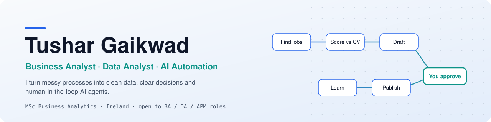
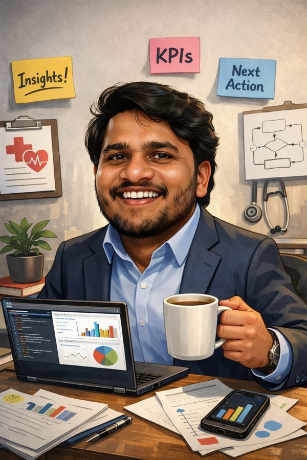

<picture>
  <source media="(prefers-color-scheme: dark)" srcset="assets/banner-dark.svg">
  
</picture>

<div align="center">


<br/>


<br/>


<a href="https://github.com/tushargaikwad1107?tab=followers"></a>

</div>

---

## 👤 Who I am

<table>
<tr>
<td width="65%" valign="top">

```typescript
const tushar = {
  title: "Business Analyst → Product Manager",
  domain: "B2B healthtech SaaS (genomic diagnostics)",
  education: "MSc Business Analytics, Dublin Business School",
  stack: {
    analysis: ["BRD", "FRD", "PRD", "Process mapping", "UAT", "Agile / Scrum"],
    data: ["SQL", "Python", "Power BI (DAX / M)", "Tableau", "Advanced Excel"],
    automation: ["n8n", "LLM agents", "Google Apps Script", "Docker"],
  },
  launchedProjects: [
    "B2B sales platform: owned BRD, FRD and PRD from idea to company-wide rollout",
    "6 Power BI dashboards across 4 business units, client reporting time down 25%",
    "LinkedIn Guardian: human-in-the-loop AI agent for job search (9 n8n workflows)",
  ],
  certifications: [
    "IBM Data Visualisation",
    "IBM Machine Learning with Python",
    "Scrum Fundamentals",
    "Google AI Essentials",
  ],
  status: "Finishing MSc, based in Ireland",
  openTo: ["Business Analyst", "Data Analyst", "Associate Product Manager"],
};
```

</td>
<td width="35%" align="center" valign="middle">

</td>
</tr>
</table>

---

## 🚀 Featured project

### 🛡️ LinkedIn Guardian

A human-in-the-loop AI agent that runs my job search: it scouts roles across Ireland, scores each one 0-100 against my CV, drafts outreach and posts in my voice, and **never sends anything without my approval**.

<a href="https://github.com/tushargaikwad1107/linkedin-guardian">
  
</a>

| Layer | Technology |
|---|---|
| Orchestration | n8n (9 workflows), Docker |
| AI | Groq (gpt-oss, Llama), Google Gemini |
| Data & console | Google Sheets, Google Docs, Google Drive |
| Inputs | Greenhouse / Lever / Ashby APIs, Jooble, Google Jobs, Gmail alerts |
| Approvals & output | Slack API, LinkedIn API |
| Quality control | Rule-based lint in JavaScript (no invented numbers or false claims) |

<a href="https://github.com/tushargaikwad1107/linkedin-guardian"></a>

---

## 🧰 Tech stack

<div align="center">

**Languages**


**Data & databases**


**Cloud & infra**


**Dev tools**


**BI, automation & AI**


</div>

---

## 📊 GitHub stats

<div align="center">


</div>

---

## 🤝 Connect

<div align="center">

<a href="https://www.linkedin.com/in/tushargaikwadba/"></a>
<a href="mailto:tushargaikwad1107@gmail.com"></a>

</div>


